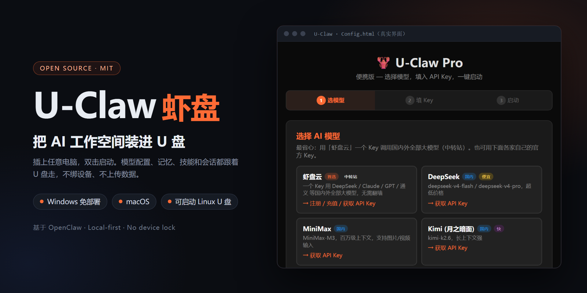
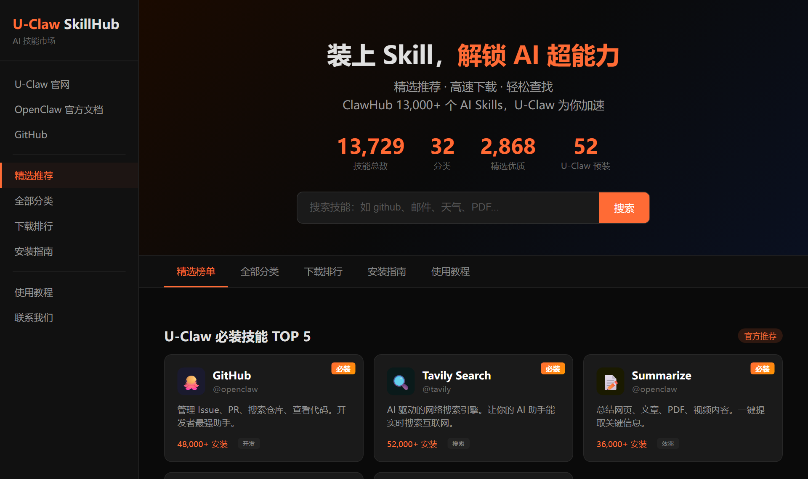

<p align="center">
  
</p>

<h1 align="center">U-Claw（虾盘）</h1>

<p align="center"><strong>把 AI 工作空间装进 U 盘：插上任意电脑，配置、记忆和工具都跟着走。</strong></p>

<p align="center">
  <a href="https://github.com/dongsheng123132/u-claw/releases">下载便携版</a> ·
  <a href="https://u-claw.org/tutorial.html">完整教程</a> ·
  <a href="#快速开始制作便携版-u-盘">从源码制作</a> ·
  <a href="#企业服务">企业服务</a> ·
  <a href="#english">English</a>
</p>

<p align="center">
  <a href="https://opensource.org/licenses/MIT"></a>
  
  
</p>

> [!IMPORTANT]
> 这不是 U 盘制作工具。这个仓库就是 U 盘的文件骨架：运行一次 `setup.sh` 补齐运行时，再把整个 `portable/` 拷到盘里即可。

> [!TIP]
> **AI 装电脑，U 盘管随身。** 在 U 盘里直接跑完整 OpenClaw 很耗 IO（实测见 [装电脑还是放 U 盘](#pc-vs-usb)）：长期用建议装电脑版；U 盘版只留给「换台电脑配置跟着走」和「不能装软件的电脑」。

## 三步开始

> 📺 图文教程：[docs/快速上手.md](docs/快速上手.md)（从插 U 盘、恢复钱包到开始对话）


1. 从 [Releases](https://github.com/dongsheng123132/u-claw/releases) 下载 Windows 便携版，解压到 U 盘后双击 `Windows-Start.bat`。
2. 或克隆仓库，在 `portable/` 运行 `bash setup.sh`，下载 Node.js 与 OpenClaw。
3. 启动直接进入 OpenClaw WebUI，在侧栏「设备钱包」领取或恢复虾盘云钱包；默认模型自动配置，可一键充值。

| 你得到什么 | 为什么重要 |
| --- | --- |
| 随身 AI 工作空间 | 换电脑时带走配置、记忆、会话与设备授权；仅可重建的浏览器缓存留在主机。 |
| 本地优先 | 不绑定设备、不打指纹、不上传本地配置。 |
| 多种使用方式 | 便携 U 盘、在线一键安装、可启动 Linux U 盘各自独立。 |

*平台支持：Windows ✅（免部署完整包）· macOS ✅ · 可启动 Linux U盘 ✅ —— 详见下方平台支持表。*

## 真实界面

启动直接进入 OpenClaw WebUI。侧栏「设备钱包」与对话顶部的「设备钱包 · 充值」提供余额、充值、密钥备份和恢复；模型配置与钱包共用本地配置，不需要前置选择。

**SkillHub 技能市场**：随盘附带的本地页面，浏览 ClawHub 上的技能，按分类找、看安装量。

<p align="center"></p>


> [!TIP]
> ### 👑 同作者新品：U-King · AI 装机管家
> 一键装好 **Claude Code / Codex / OpenClaw / Hermes** 四大 AI 神器，驱动自动配好——一个 Key 直用 Claude、GPT、DeepSeek、Kimi 等 24+ 全球模型，免翻墙。绿色版仅几 MB，双击即用，还带 AI 作图 / 视频 / 本地大模型 / 多终端工作台。
>
> **免费下载：[www.u-king.org](https://www.u-king.org)**（国内镜像 [cloud.u-claw.org/uking](https://cloud.u-claw.org/uking/)）
>
> *U-Claw 让 AI 住进 U 盘；U-King 帮你把全套 AI 编程神器装进电脑。*
> *EN: U-King — one-click installer for Claude Code / Codex / OpenClaw, with one API key for 24+ global models → [u-king.org](https://www.u-king.org)*

---

<a id="中文"></a>

## 中文

### 这是什么

U-Claw（虾盘）是一个**制作教程 + 全套源代码**，教你把 [OpenClaw](https://github.com/openclaw/openclaw)（开源 AI 助手框架）做成 U 盘——插上任意电脑，双击就能用 AI。为什么叫虾盘？U-Claw = USB + Claw（虾钳），U 盘 + AI = 虾盘。

代码库本身就是 U 盘的文件骨架，运行 `setup.sh` 补齐大依赖后，整个 `portable/` 目录直接拷贝到 U 盘即可。

> 📖 **[完整教程](https://u-claw.org/tutorial.html)** — 从零开始的手工安装指南、设备钱包、模型配置和充值，小白也能看懂。

### 模型：虾盘云默认，也能填自己的 Key

本版使用 OpenClaw 2026.10.2 和 Node.js 24.16.0。默认走虾盘云 `deepseek-v4-flash`：钱包接入原生 WebUI，领取或恢复密钥后自动配置默认模型；启动不会自动领钱包，已有钱包可以继续使用和一键充值。想用自己的模型也行——首次启动的配置页可以直接选 DeepSeek / Kimi / 智谱 GLM / 通义 / 豆包 / MiniMax / OpenAI / Claude / Groq / 硅基流动，或选「自定义 · OpenAI 兼容」填 API 地址、模型 ID 和 Key。配置与钱包状态保存在 U 盘 `data/.openclaw/`。

首次在 Mac 运行或同盘更换操作系统时，setup 会联网准备当前平台依赖；Windows 完整包已准备好 Windows 依赖。

### 包内附带的轻量版（虾盘精灵）

Windows 完整包里还附了 `lite-windows-x64/`：虾盘 U 盘精灵的轻量版（约 45MB，不依赖 Node/OpenClaw）。双击 `虾盘.exe` 即用，支持自填任意 OpenAI 兼容 Key，以及系统体检、网络检查、启动项查看等本地维护动作。老电脑、低速 U 盘、只需要轻量对话时用它；完整 OpenClaw 能力仍用 `Windows-Start.bat`。

### 一键安装（推荐）

不需要 U 盘，一行命令直接装到电脑：

```bash
# Mac / Linux
curl -fsSL https://u-claw.org/install.sh | bash

# Windows (PowerShell 管理员)
irm https://u-claw.org/install.ps1 | iex
```

自动完成: Node.js 下载 → OpenClaw 安装 → 10 个中国技能 → 模型配置 → 启动脚本生成。全程国内镜像，无需翻墙。

详见 [`install/README.md`](install/README.md)。

<a id="pc-vs-usb"></a>

### 装电脑还是放 U 盘？先看 IO

**结论：AI 引擎（OpenClaw）装电脑，U 盘负责「随身」。**

U 盘版的价值是「换台电脑，配置、钱包、会话、记忆跟着走」，而不是「把 AI 运行时塞进 U 盘」。完整便携包是约 620 MB、4.4 万个文件；把它放进 U 盘、每次插上启动，都要付出实打实的 IO 成本。同版本、同机器实测（2026-10-21，Windows 11 x64 / i9-12900H / USB 3.0 exFAT U 盘；单机单盘，不同 U 盘主控差异可能很大）：

| 对比项 | 装电脑（同一个包拷到本机 NVMe） | 完整便携包放 U 盘 | U 盘轻壳（方向） |
| --- | --- | --- | --- |
| 占盘空间 / 文件数 | 620 MB / 4.4 万 | 620 MB / 4.4 万 | **约 9 MB / 几十个** |
| 投盘（复制/解压到盘上） | 15 秒 | **实测 56 分钟**（4.4 万个小文件） | 约 7 秒 |
| 启动到可用 | 首次 168 秒；之后约 67 秒 | 首次 90 秒¹；之后 67~78 秒 | **0.1 秒** |
| 启动期间读盘 | 约 145 MB² | 约 69 MB¹ | 约 0.1 MB |
| 启动期间写盘 | 约 412 MB² | 约 7 MB，首启后还要再写约 45 MB UI 资源¹ | 0 MB |
| 启动后静置 1 分钟 | 背景噪声大，不可比² | 首启 ≈ 61 / 40 MB；之后 < 2 MB | ≈ 0 |
| 换台电脑再启动 | — | **再冷启动一次**（本机缓存不随盘） | 常驻，秒开 |
| U 盘格式要求 | — | NTFS 最佳；exFAT 可跑但更慢；FAT32 不支持 | exFAT / FAT32 / NTFS 都行 |

¹ 冷启动「只读 69 MB」偏小：解压刚写完，Windows 文件缓存还热（本机 64 GB 内存）；重启或换台电脑拔插的冷读会明显更大（未测）。exFAT 上还实测到慢 SQLite 事务告警：启动单步 checkpoint 8.5 秒（正常阈值 1 秒）。
² 本机盘是系统盘，读写计数含其它程序的背景 IO，只作量级参考。

> 注意：启动秒数两边都在一分钟上下——OpenClaw 本身就不轻，这不是 U 盘版的短板。U 盘版真正的代价是**投盘要一小时、每次换电脑都要重新冷启动并读写 U 盘、exFAT 上的慢事务、以及 U 盘损耗**；这些在轻壳上基本不存在（投盘 7 秒、启动 0.1 秒）。

为什么差这么多：

1. **小文件随机 IO 是 U 盘的死穴。** 这只 U 盘实测小文件创建约 43 个/秒（投盘并发时 13 个/秒）、顺序写约 7~13 MB/s；4.4 万个 `node_modules` 小文件投进去实测 56 分钟，同一份东西拷到本机 NVMe 只要 15 秒。
2. **每次换电脑都要重新冷启动。** `process.bootstrap`（加载 OpenClaw 模块图）是启动的大头；热启动之所以能和本机 SSD 打平，是因为 V8 编译缓存、npm 缓存、日志、临时文件都搬到了本机盘——但换一台电脑，这些缓存不跟着走，冷启动要重来，首次还要再往 U 盘写约 45 MB UI 资源。
3. **写入磨损与文件系统能力。** 日志、SQLite、索引一直在写；exFAT 没有文件身份（inode）和符号链接，要靠兼容补丁绕，慢且能力受限（实测启动 SQLite 单步 8.5 秒）。U 盘是消耗品，别拿它当系统盘用。
4. **通配性。** 轻壳是一个几 MB 的原生程序：不装 Node、不建链接，所以 exFAT/FAT32/NTFS、任何盘符、Windows/macOS 都能直接开——这才是真正的「插哪台都能用」。完整包在 exFAT 上能跑但更慢，FAT32 直接不支持。

**我们已经做的优化**（完整便携包仍然有效）：把「可再生成」的东西搬出 U 盘——受管浏览器资料、V8 编译缓存、npm 缓存、临时文件都走本机盘（`lib/portable-cache.mjs`，Windows 在 `%LOCALAPPDATA%\U-Claw`），只有配置、会话、设备身份、钱包留在 U 盘随盘走。即便如此，运行时本体还是要从 U 盘读。

**怎么选：**

| 你的场景 | 建议 |
| --- | --- |
| 天天用、要快 | **装电脑版**：`irm https://u-claw.org/install.ps1 \| iex`（macOS / Linux 用 `install.sh`） |
| 多台电脑之间带着配置和钱包走 | 电脑装 OpenClaw，U 盘只带配置；或等 U 盘轻壳 |
| 别人的电脑上不能装任何东西 | 完整便携包放 U 盘（它就是为这个场景留的） |
| 老电脑 / 慢 U 盘 | 别在 U 盘上跑 OpenClaw，装电脑版 |

**U 盘轻壳（`u-claw-lite`，开发中）**：U 盘里只放一个几 MB 的原生程序，提供一个本地页面管钱包、模型设置、会话入口和维护工具；电脑上装好 OpenClaw 后一键拉起。**轻壳不内置 OpenClaw**——所以「实在需要 OpenClaw」时，直接在电脑上装电脑版即可，不必从 U 盘引导。当前是预览阶段（只有 WebUI 与服务端动作，不含 OpenClaw 启动与钱包共享），落地后本仓 U 盘版会以它为主形态。

> 完整便携包不会删除：它是「免安装、可离线、救急」的形态，继续按现有方式发布。

### 快速开始：制作便携版 U 盘

```bash
# 1. 克隆代码
git clone https://github.com/dongsheng123132/u-claw.git

# 2. 补齐大依赖（Node.js + OpenClaw，国内镜像，约 1 分钟）
cd u-claw/portable && bash setup.sh

# 3. 拷贝到 U 盘
cp -R portable/ /Volumes/你的U盘/U-Claw/   # Mac
# 或 Windows 资源管理器直接拖过去
```

**完成！** 插上 U 盘，双击启动脚本就能用。

> 同一支 U 盘同时只会启动一个 U-Claw 实例。重复双击会打开已运行的 Dashboard，不会另起端口或并发写入会话；如需重启，请先退出原启动窗口。

### U 盘功能一览

| 功能 | Mac | Windows |
|------|-----|---------|
| **免安装运行** | `Mac-Start.command` | `Windows-Start.bat` |
| **功能菜单** | `Mac-Menu.command` | `Windows-Menu.bat` |
| **安装到电脑** | `Mac-Install.command` | `Windows-Install.bat` |
| **首次配置** | `Config.html` | `Config.html` |

### U 盘文件结构

```
U-Claw/                          ← 整个拷到 U 盘
├── Mac-Start.command             Mac 免安装运行
├── Mac-Menu.command              Mac 功能菜单
├── Mac-Install.command           安装到 Mac
├── Windows-Start.bat             Windows 免安装运行
├── Windows-Menu.bat              Windows 功能菜单
├── Windows-Install.bat           安装到 Windows
├── Config.html                   首次配置页面
├── setup.sh                      补齐依赖（开发者用）
├── app/                          ← 大依赖（setup.sh 下载，不进 git）
│   ├── core/                        OpenClaw
│   └── runtime/
│       ├── node-mac-arm64/          Mac Apple Silicon
│       ├── node-mac-x64/           Mac Intel
│       └── node-win-x64/           Windows 64-bit
└── data/                         ← 用户数据（不进 git）
    ├── .openclaw/                   配置文件
    ├── memory/                      AI 记忆
    └── backups/                     备份
```

### Linux 可启动版

连操作系统都没有？没关系。可启动版可以让任意电脑从 U 盘直接启动 Ubuntu + AI：

- 本仓库内：[`bootable/`](bootable/) 目录（与其他模块完全独立，互不影响）
- 独立仓库：[u-claw-linux](https://github.com/dongsheng123132/u-claw-linux)（内容一致，方便单独克隆）

基于 Ventoy + Ubuntu 24.04 LTS + 持久化存储，在 Windows 上运行 4 步 PowerShell 脚本即可制作。详见 [`bootable/README.md`](bootable/README.md)。

> **关于桌面安装版（Electron）**：`u-claw-app/` 的 Electron 桌面版（`.exe` 安装版 / 绿色版 / `.dmg`）**已于 2026-06-19 停止发布并归档**，原因见 [`u-claw-app/DEPRECATED.md`](u-claw-app/DEPRECATED.md)。U-Claw 现在只发布「便携 U 盘版」——这才是产品的本质：插上 U 盘、解压即用。

### 直接下载发行版

[GitHub Releases](https://github.com/dongsheng123132/u-claw/releases) 提供便携 U 盘版：

- `u-claw-portable-windows-vX.Y.Z.zip` — Windows 便携完整版（已预装 Node + OpenClaw，**解压到 U 盘双击 `Windows-Start.bat` 即用**）
- **Mac**：源码在 [`portable/`](portable/) 目录，`bash setup.sh` 自动下载 Node + OpenClaw（国内镜像约 1 分钟），双击 `Mac-Start.command` 启动

> ⚠️ **完整便携包优先 NTFS，不要 FAT32**：NTFS 走原生路径，最快最稳；exFAT 自 v2.3.0 起会自动启用经版本与 SHA-256 校验的兼容补丁——能正常启动，但目录监听改为轮询、首次启动与重启更慢、个别插件/技能的链接能力受限（Windows + macOS 双系统共用一只盘时用它）；FAT32 不支持。
>
> 两种格式的实测差异（v2.1.20，真机验证）：
>
> | | exFAT / FAT32 | NTFS |
> |---|---|---|
> | 网关启动与对话 | ✅ 正常可用 | ✅ 正常可用 |
> | V8 编译缓存落本机加速 | ✅ 生效（缓存自动放 `%LOCALAPPDATA%\U-Claw`） | ✅ 同左 |
> | 浏览器用户数据与缓存 | ✅ 受管 Chromium 自动落在本机盘 | ✅ 同左 |
>
> 一句话：浏览器与 Node 的可重建高频 IO 会自动落在本机盘；`data/.openclaw` 中的 SQLite 会话、设备身份、授权与配置始终随 U 盘携带。换电脑后浏览器网站登录态需要在该电脑重新登录。仍建议使用 NTFS，以避免安装依赖或其它需要链接能力的操作在 exFAT/FAT32 上变慢或受限。

### 模型与使用入口

默认模型：虾盘云 `deepseek-v4-flash`；也可以填自己的 Key——配置页选第三方官方 Key，或「自定义 · OpenAI 兼容」填任意 API 地址 + 模型。使用 OpenClaw WebUI 对话；微信、飞书、Telegram、QQ 等接入入口及额外插件已移除。

### 国内镜像

所有脚本默认走国内镜像，无需翻墙：

| 资源 | 镜像 |
|------|------|
| npm 包 | `registry.npmmirror.com` |
| Node.js | `npmmirror.com/mirrors/node` |
| Electron | `npmmirror.com/mirrors/electron` |

### 开发 & 贡献

```bash
git clone https://github.com/dongsheng123132/u-claw.git
cd u-claw/portable && bash setup.sh
bash Mac-Start.command   # Mac 测试
```

**平台支持：**

| 平台 | 状态 | 说明 |
|------|------|------|
| Mac Apple Silicon (M1-M4) | ✅ | 便携版 |
| Mac Intel (x64) | ✅ | 便携版 |
| Windows x64 | ✅ | 便携版（含免部署完整包） |
| Linux x64（可启动 U 盘） | ✅ | [`bootable/`](bootable/) 目录 |

欢迎 PR！特别需要：教程翻译、文档完善。

### 🦞 寻找技术伙伴

U-Claw 是一个快速成长的开源项目，目前已有不少商业合作机会。

我们正在寻找：
- **技术伙伴** — 全栈 / Node.js / Electron / 脚本自动化
- **资源合作** — 渠道、内容、社区运营

如果你对 AI 工具的落地和商业化感兴趣，欢迎联系：

- 微信: hecare888
- Telegram: [@dsds8848](https://t.me/dsds8848)
- Twitter/X: [@Bitplus888](https://x.com/Bitplus888)
- Email: [hefangsheng@gmail.com](mailto:hefangsheng@gmail.com)
- GitHub: [@dongsheng123132](https://github.com/dongsheng123132)
- 官网: [u-claw.org](https://u-claw.org)

### FAQ

**Q: 需要翻墙吗？**
不需要。安装和运行全程使用国内镜像，国产模型 API 直连。

**Q: U 盘需要多大？**
4GB+ 就够（v2.3.x 完整包约 618 MB / 4.4 万个文件；早期全量包约 2.3 GB）。

**Q: 能分发吗？**
MIT 协议，随便复制分发。

**Q: Mac 提示"未验证的开发者"？**
右键脚本 → 打开。

**Q: setup.bat / setup.sh 执行失败，提示模块找不到？**
通常是 npm install 过程中网络中断导致 `node_modules` 不完整。解决步骤：
1. 删除不完整的依赖：`rmdir /s /q portable\app\core\node_modules`（Windows）或 `rm -rf portable/app/core/node_modules`（Mac）
2. 切换淘宝镜像重新安装：`cd portable/app/core && npm install --registry=https://registry.npmmirror.com`

**Q: 系统已有 Node.js v24，安装失败？**
Node.js v24 是最新开发版，部分依赖尚不兼容。需要 **v20 或 v22 LTS**。删除已下载的 runtime 目录后重新运行 setup，它会自动下载内置的 Node v22：
```bash
# Windows
rmdir /s /q portable\app\runtime\node-win-x64
setup.bat

# Mac
rm -rf portable/app/runtime/node-mac-arm64
bash setup.sh
```

**Q: Mac 上提示 `.toSorted is not a function`？**
系统旧版 Node.js 被检测到并跳过了内置版本下载，但旧版 Node 不支持 `.toSorted()`（需要 v20+）。重新运行 setup 升级到内置 Node 24.16.0：
```bash
rm -rf portable/app/runtime/node-mac-arm64
bash setup.sh
```

**Q: 如何设置模型和充值？**
打开 WebUI 的「设备钱包」，领取或导入已有虾盘云密钥，默认模型自动配置。点击「一键充值」即可打开充值页面。

**Q: U 盘安装后无法创建文件 / 写入失败？**
先检查 U 盘写保护开关、剩余空间和写入权限，再查看启动窗口的具体错误及日志。

**Q: 从 Ubuntu 向 U 盘复制时符号链接丢失？**
`node_modules/.bin/` 下有大量符号链接，FAT32/exFAT 在直接 `cp -R` 时会跳过。用 `rsync -aL` 可将符号链接展开为真实文件：
```bash
rsync -aL --progress portable/ /media/YOUR_USB/U-Claw/
```

<a id="企业服务"></a>

### 💼 企业 AI 落地服务（付费）

U-Claw 免费开源，自己装了用完全够，不用买任何东西。

但如果你要把 AI **落进公司的业务流程**——客服、文档、质检、报价、内部知识库——
那是另一件事。我是 [贺去病](https://hequbing.com)，独立 AI 产品开发者，做过 50+ 个交付项目，
方案到上线一个人能兜住。这部分按项目收费：

| 服务 | 你拿到什么 | 价格 |
| :-- | :-- | :-- |
| **AI 需求诊断** | 30 分钟通话：哪些环节值得上 AI、哪些是坑、大概多少钱 | **免费** |
| **AI 方案设计** | 完整方案：技术选型 + 成本估算 + 实施路径 | ¥3,000 起 |
| **快速 POC** | 2 周内交付能演示的原型，先验证可行再投钱 | ¥8,000 起 |
| **落地陪跑** | 从方案到上线全程跟，含团队培训 | ¥20,000 起 |
| **U-Claw 企业定制** | 私有化部署、批量装机、内网版、白标 | 面议 |

**从免费诊断开始，不合适我会直接说不合适** —— 微信 hecare888 ·
[hefangsheng@gmail.com](mailto:hefangsheng@gmail.com) · [hequbing.com](https://hequbing.com)

---

### 联系 & 合作


- 微信: hecare888（或扫右侧二维码）
- Telegram: [@dsds8848](https://t.me/dsds8848)
- Twitter/X: [@Bitplus888](https://x.com/Bitplus888)
- Email: [hefangsheng@gmail.com](mailto:hefangsheng@gmail.com)
- GitHub: [@dongsheng123132](https://github.com/dongsheng123132)
- 官网: [u-claw.org](https://u-claw.org)

**🤝 招募代理 / 带货合作**

虾盘 3.0 体验极佳，退货率极低，售后由我们负责——你只管卖货：

- **抖店 / 直播带货**：提供最高佣金比例，产品已在多个直播间验证转化
- **代理分销**：买断或按单分润均可谈，支持定制版本
- **技术合作**：有开发能力者欢迎深度合作
- **👑 U-King 装机管家分销（新）**：[U-King](https://www.u-king.org) 软件本身免费送客户，客户按用量给 AI 模型 API 充值，你拿**持续分润**——不压货、零售后（我们负责），赚的是长期流水。适合装机店、AI 培训、社群主理人

有意向请微信联系（备注「代理合作」优先处理）。

---

<a id="english"></a>

## English

<p align="center">
  <a href="https://github.com/dongsheng123132/u-claw/releases">Download</a> ·
  <a href="https://u-claw.org/tutorial.html">Full tutorial</a> ·
  <a href="#enterprise-services">Enterprise services</a>
</p>

### What is this

U-Claw (aka "虾盘" / "Xia Pan" in Chinese, meaning "Claw Drive") is a **tutorial + complete source code** for building an [OpenClaw](https://github.com/openclaw/openclaw) (open-source AI assistant framework) USB drive — plug it into any computer, double-click, and start using AI.

The codebase itself is the USB file skeleton. Run `setup.sh` to download large dependencies, then copy the entire `portable/` directory to a USB drive.

> 📖 **[Full Tutorial](https://u-claw.org/tutorial.html)** — Step-by-step manual installation, model setup, chat platform integration.

### One-Line Install (Recommended)

No USB needed — install directly to your computer:

```bash
# Mac / Linux
curl -fsSL https://u-claw.org/install.sh | bash

# Windows (PowerShell as Admin)
irm https://u-claw.org/install.ps1 | iex
```

Automatically downloads Node.js, installs OpenClaw, configures 10 Chinese-optimized skills, and sets up your AI model. All downloads use China mirrors.

See [`install/README.md`](install/README.md) for details.

<a id="pc-vs-usb-en"></a>

### Install on the PC, or run from USB? Mind the I/O

**Short version: run OpenClaw on the computer; use the USB drive for portability.**

The USB build's value is "your config, wallet, sessions and memory travel with the drive", not "the AI runtime lives on the stick". The full portable package is ~620 MB across ~44,000 small files, and putting it on a USB stick has a real I/O cost. Same build, same machine, one stick (2026-10-21, Windows 11 x64 / i9-12900H / USB 3.0 exFAT; controllers differ, your mileage may vary):

| | On the PC (same package on NVMe SSD) | Full portable package on USB | Light USB shell (roadmap) |
| --- | --- | --- | --- |
| Disk footprint / files | 620 MB / 44k | 620 MB / 44k | **~9 MB / a few dozen** |
| Copying it onto the disk | 15 s | **56 min measured** (44k small files) | ~7 s |
| Startup to usable | 168 s first run; ~67 s after | 90 s first run¹; 67–78 s after | **0.1 s** |
| Read at startup | ~145 MB² | ~69 MB¹ | ~0.1 MB |
| Write at startup | ~412 MB² | ~7 MB, plus ~45 MB of UI assets after first run¹ | 0 MB |
| Idle 60 s after start | background noise² | first run ≈61 / 40 MB; then <2 MB | ≈0 |
| New computer | — | **cold start again** (host caches do not travel) | resident, instant |
| Filesystem | — | NTFS best; exFAT works but slower; FAT32 unsupported | exFAT / FAT32 / NTFS all fine |

¹ The 69 MB read is low because Windows' file cache was still warm right after extraction (64 GB RAM); a reboot or a fresh plug on another PC will read more (not measured). We also captured slow SQLite transaction warnings on exFAT: 8.5 s for a single startup checkpoint step (threshold 1 s).
² C: is the system disk, so its counters include unrelated background I/O; order of magnitude only.

> Note: startup takes about a minute either way — OpenClaw itself is heavy, so that is not the USB build's weak spot. The real cost of running it from USB is the one-hour copy, a cold start on every new machine that reads and writes the stick, slow transactions on exFAT, and stick wear. The light shell removes those costs (7 s copy, 0.1 s start).

Why it costs so much:

1. **Random small-file I/O is the weak spot of USB sticks.** This stick creates ~43 small files/s when idle (13/s while the copy was running) and writes ~7–13 MB/s sequentially; 44k `node_modules` files took 56 minutes to put on it, while the same tree copies to an NVMe SSD in 15 s.
2. **Every new computer means another cold start.** `process.bootstrap` (loading the OpenClaw module graph) dominates startup; warm restarts match the SSD because the V8 compile cache, npm cache, logs and temp files live on the host disk — but those caches do not travel with the stick, so a different computer starts cold again and writes ~45 MB of UI assets to the stick on first run.
3. **Write wear and filesystem limits.** Logs, SQLite and caches write constantly; exFAT has no inodes or symlinks, so it needs compatibility patches and stays slower (measured: 8.5 s for a single SQLite startup step). A USB stick is consumable — don't use it as a system disk.
4. **Compatibility.** A few-MB native shell needs no Node and no links, so it runs on exFAT/FAT32/NTFS, any drive letter, Windows and macOS. That is real "plug into any computer" compatibility, while the full package needs patches on exFAT and refuses FAT32.

What we already do: the managed-browser profile, V8 compile cache, npm cache and temp files live on the host disk (`lib/portable-cache.mjs`, Windows `%LOCALAPPDATA%\U-Claw`); only config, sessions, device identity and wallet stay on the stick.

**Choose:** everyday use → install on the PC (`irm https://u-claw.org/install.ps1 | iex`, or `install.sh` on macOS/Linux). "I cannot install anything on this computer" → full portable package on USB. Slow PC / slow stick → do not run OpenClaw from USB.

**Light USB shell (`u-claw-lite`, in development):** a few-MB native program on the stick that serves a local page for wallet, model setup, session entry and maintenance tools, and launches the PC-installed OpenClaw. It does **not** bundle OpenClaw — so users who really need OpenClaw should install the desktop version on the computer. Status: preview (WebUI and server actions only; OpenClaw launch and wallet sharing are not integrated yet).

### Quick Start: Build a Portable USB

```bash
# 1. Clone
git clone https://github.com/dongsheng123132/u-claw.git

# 2. Download dependencies (Node.js + OpenClaw, ~1 min)
cd u-claw/portable && bash setup.sh

# 3. Copy to USB drive
cp -R portable/ /Volumes/YOUR_USB/U-Claw/   # Mac
# Or drag & drop on Windows
```

**Done!** Plug in the USB, double-click the start script, and you're running AI.

> Only one U-Claw instance runs per USB drive. A second click reopens the existing Dashboard instead of selecting another port or writing sessions concurrently. To restart, exit the original launcher first.

### USB Features

| Feature | Mac | Windows |
|---------|-----|---------|
| **Run (no install)** | `Mac-Start.command` | `Windows-Start.bat` |
| **Menu** | `Mac-Menu.command` | `Windows-Menu.bat` |
| **Install to PC** | `Mac-Install.command` | `Windows-Install.bat` |
| **First-time config** | `Config.html` | `Config.html` |

### File Structure

```
U-Claw/                          ← Copy entire folder to USB
├── Mac-Start.command             Mac launcher
├── Mac-Menu.command              Mac menu
├── Mac-Install.command           Install to Mac
├── Windows-Start.bat             Windows launcher
├── Windows-Menu.bat              Windows menu
├── Windows-Install.bat           Install to Windows
├── Config.html                   First-time config page
├── setup.sh                      Download dependencies (dev use)
├── app/                          ← Large deps (downloaded by setup.sh, not in git)
│   ├── core/                        OpenClaw
│   └── runtime/
│       ├── node-mac-arm64/          Mac Apple Silicon
│       ├── node-mac-x64/           Mac Intel
│       └── node-win-x64/           Windows 64-bit
└── data/                         ← User data (not in git)
    ├── .openclaw/                   Config file
    ├── memory/                      AI memory
    └── backups/                     Backups
```

### Linux Bootable USB

No operating system? No problem. Boot any computer from USB into Ubuntu + AI:

- In this repo: [`bootable/`](bootable/) directory (fully independent from other modules)
- Standalone repo: [u-claw-linux](https://github.com/dongsheng123132/u-claw-linux) (same content, easier to clone separately)

Based on Ventoy + Ubuntu 24.04 LTS + persistence. 4-step PowerShell scripts on Windows. See [`bootable/README.md`](bootable/README.md) for details.

> **About the Electron desktop app**: `u-claw-app/` (the `.exe` installer / portable / `.dmg` builds) was **deprecated and is no longer published as of 2026-06-19** — see [`u-claw-app/DEPRECATED.md`](u-claw-app/DEPRECATED.md). U-Claw now ships only the portable USB build, which is the product's essence: plug in the USB and run.

### Model and interface

This edition uses OpenClaw 2026.10.2 with Node.js 24.16.0 and defaults to the Xiapan Cloud model `deepseek-v4-flash` (device wallet + recharge inside the native WebUI). **Bring your own API key too**: the setup page lists DeepSeek / Kimi / Zhipu GLM / Qwen / Doubao / MiniMax / OpenAI / Claude / Groq / SiliconFlow, plus a "Custom · OpenAI compatible" card for any base URL + model + key. Channel connection entries and extra messaging plugins have been removed. The first launch on another operating system prepares its native dependencies through setup.

A **`lite-windows-x64/`** folder is bundled inside the Windows package: the ~45 MB Go-native Xiapan USB Genie lite build (no Node/OpenClaw needed). Double-click `虾盘.exe`; it supports any OpenAI-compatible key plus local maintenance actions (system check, network check, startup items). Use it on old PCs or slow USB sticks.

### China Mirrors

All scripts use China mirrors by default — no VPN needed:

| Resource | Mirror |
|----------|--------|
| npm packages | `registry.npmmirror.com` |
| Node.js | `npmmirror.com/mirrors/node` |
| Electron | `npmmirror.com/mirrors/electron` |

### Development & Contributing

```bash
git clone https://github.com/dongsheng123132/u-claw.git
cd u-claw/portable && bash setup.sh
bash Mac-Start.command   # Test on Mac
```

**Platform Support:**

| Platform | Status | Notes |
|----------|--------|-------|
| Mac Apple Silicon (M1-M4) | ✅ | Portable |
| Mac Intel (x64) | ✅ | Portable |
| Windows x64 | ✅ | Portable (full offline bundle) |
| Linux x64 (Bootable USB) | ✅ | [`bootable/`](bootable/) directory |

PRs welcome! Especially: documentation, tutorials.

### 🔧 Professional Services / 专业服务

Need help? We offer remote support and custom development:

| Service | Description | Price |
|---------|-------------|-------|
| **Remote Installation** | We remotely install OpenClaw + skills + model config for you | Free |
| **Troubleshooting** | Startup failures, port conflicts, network issues | From ¥50 |
| **Model Tuning** | API key setup, model switching, prompt optimization | From ¥50 |
| **Custom Development** | Custom skills, enterprise private deployment, QQ/WeChat/Feishu bot integration | From ¥200 |
| **USB Green Edition** | Pre-built portable USB with your custom skills & models | From ¥100 |

**One-click remote support** — run one command, we connect and fix it:

```bash
# Mac / Linux
curl -fsSL https://u-claw.org/remote.sh | bash

# Windows (Admin PowerShell)
irm https://u-claw.org/remote.ps1 | iex
```

WeChat: **hecare888** (备注「U-Claw 远程」优先处理)

👉 [View full service details / 查看完整服务详情](https://u-claw.org/guide.html#remote-support)

### 🦞 Looking for Partners

U-Claw is a fast-growing open-source project with real commercial opportunities.

We're looking for:
- **Technical partners** — Full-stack / Node.js / Electron / scripting
- **Resource partners** — Distribution, content, community

If you're interested in AI tooling and commercialization, let's talk:

- Telegram: [@dsds8848](https://t.me/dsds8848)
- Twitter/X: [@Bitplus888](https://x.com/Bitplus888)
- Email: [hefangsheng@gmail.com](mailto:hefangsheng@gmail.com)
- GitHub: [@dongsheng123132](https://github.com/dongsheng123132)
- WeChat: hecare888
- Website: [u-claw.org](https://u-claw.org)

### FAQ

**Q: Do I need a VPN?**
No. All downloads use China mirrors. Chinese AI model APIs work directly.

**Q: How big should the USB drive be?**
4GB+ is enough (~618 MB / 44k files for the v2.3.x package; earlier full builds were ~2.3 GB).

**Q: Can I redistribute?**
MIT license — copy and share freely.

**Q: Mac says "unverified developer"?**
Right-click the script → Open.

**Q: setup.bat / setup.sh fails with "module not found"?**
Usually caused by a network interruption during `npm install`, leaving `node_modules` incomplete. Fix:
1. Delete incomplete dependencies: `rmdir /s /q portable\app\core\node_modules` (Windows) or `rm -rf portable/app/core/node_modules` (Mac)
2. Reinstall using China mirror: `cd portable/app/core && npm install --registry=https://registry.npmmirror.com`

**Q: Already have Node.js v24 and installation fails?**
Node.js v24 is a dev release — some dependencies aren't compatible yet. You need **v20 or v22 LTS**. Delete the runtime folder to force a fresh download of the bundled Node v22:
```bash
# Windows
rmdir /s /q portable\app\runtime\node-win-x64
setup.bat

# Mac
rm -rf portable/app/runtime/node-mac-arm64
bash setup.sh
```

**Q: Mac shows `.toSorted is not a function`?**
Your system Node.js was detected and the bundled version was skipped, but the system version is too old (needs v20+). Delete the runtime folder to re-download the bundled Node v22:
```bash
rm -rf portable/app/runtime/node-mac-arm64
bash setup.sh
```

**Q: How do I use multiple AI models / providers?**
Multiple providers are supported! Open `Config.html` → click "Add" in the Providers section → enter API Key and endpoint for each model (DeepSeek, Kimi, Qwen, etc.) → save. Switch between models via the dropdown in the chat interface. Config is saved persistently on the USB drive.

**Q: USB drive shows "cannot create file" / write errors?**
Check the drive's write-protect switch, free space and write permissions, then inspect the startup window and logs for the specific error.

**Q: Symlinks missing when copying from Ubuntu to USB?**
`node_modules/.bin/` contains many symlinks that get skipped during direct `cp -R`. Use `rsync -aL` to expand symlinks into real files:
```bash
rsync -aL --progress portable/ /media/YOUR_USB/U-Claw/
```

<a id="enterprise-services"></a>

### 💼 Enterprise AI Consulting (paid)

U-Claw is free and MIT-licensed. Installing it for yourself costs nothing and needs nothing from me.

Putting AI **into your company's actual workflow** — support, documents, QA, quoting, internal
knowledge bases — is a different job. I'm [He Qubing](https://hequbing.com), an independent AI product
developer with 50+ delivered projects; I can carry a project from scoping to production on my own.
That part is paid:

| Service | What you get | Price |
| :-- | :-- | :-- |
| **AI scoping call** | 30 min: what's worth automating, what will burn you, rough budget | **Free** |
| **Solution design** | Full plan: stack selection, cost model, rollout path | from ¥3,000 (~$420) |
| **Rapid POC** | A working demo in 2 weeks — validate before you spend | from ¥8,000 (~$1,100) |
| **Hands-on delivery** | Scoping through production, including team training | from ¥20,000 (~$2,800) |
| **U-Claw for teams** | Self-hosted, bulk provisioning, air-gapped, white-label | Let's talk |

**Start with the free call — if it's a bad fit I'll say so** —
[hefangsheng@gmail.com](mailto:hefangsheng@gmail.com) · [hequbing.com](https://hequbing.com)

---

### Contact & Partnership


- WeChat: hecare888 (or scan QR on the right)
- Telegram: [@dsds8848](https://t.me/dsds8848)
- Twitter/X: [@Bitplus888](https://x.com/Bitplus888)
- Email: [hefangsheng@gmail.com](mailto:hefangsheng@gmail.com)
- GitHub: [@dongsheng123132](https://github.com/dongsheng123132)
- Website: [u-claw.org](https://u-claw.org)

**🤝 Reseller / Affiliate Program**

U-Claw 3.0 delivers excellent user experience with very low return rates. We handle all after-sales support — you focus on selling:

- **Live commerce / TikTok shop**: Top commission rates, proven conversion in live streams
- **Reseller / distribution**: Revenue share or wholesale, custom branded versions available
- **Technical partnership**: Deep collaboration welcome for developers
- **👑 U-King distribution (new)**: give away [U-King](https://www.u-king.org) (free AI setup manager) — earn **recurring revenue share** on your customers' API top-ups. No inventory, we handle support

Interested? WeChat hecare888 (mention "partnership" for priority response).

---

**Made with 🦞 by [贺去病 ai 工作室](https://github.com/dongsheng123132)**
